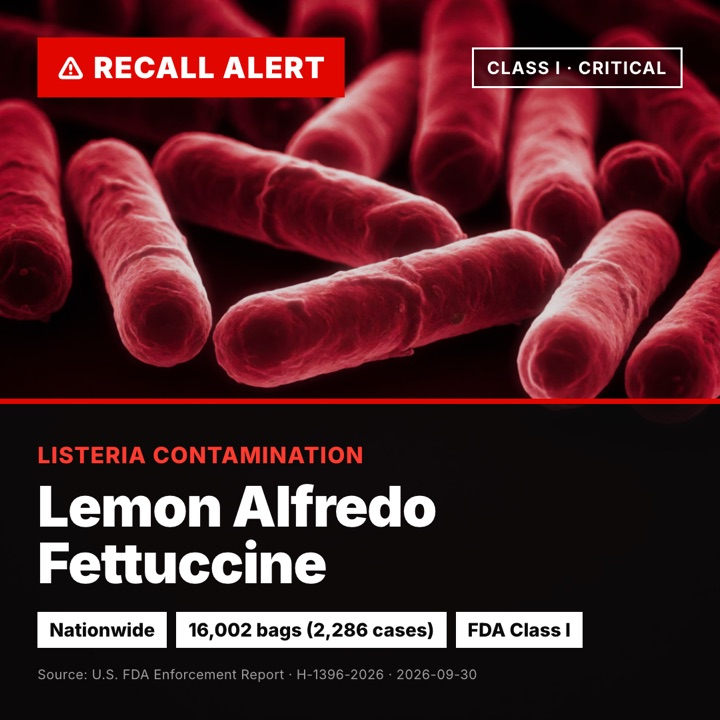
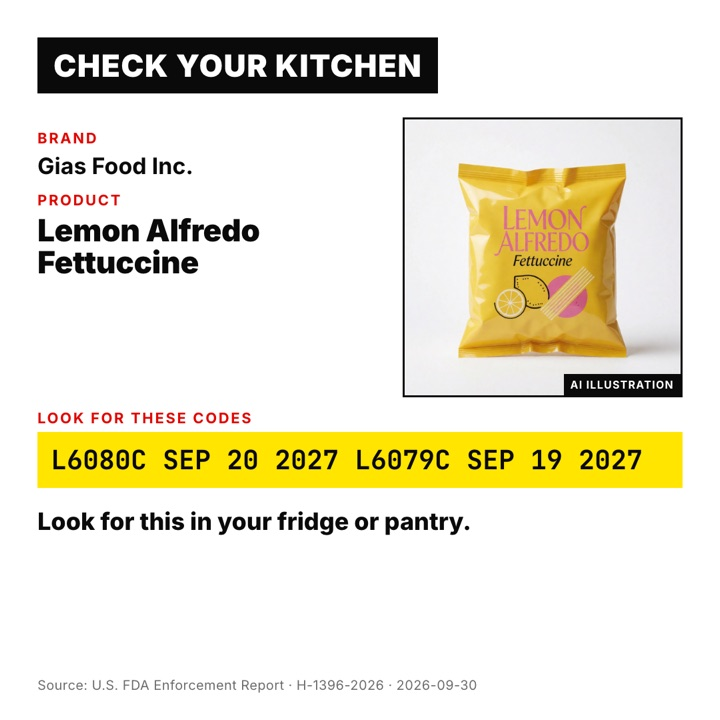
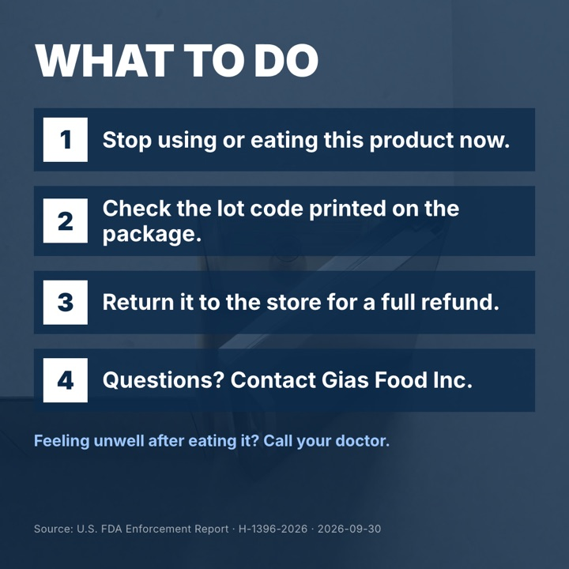
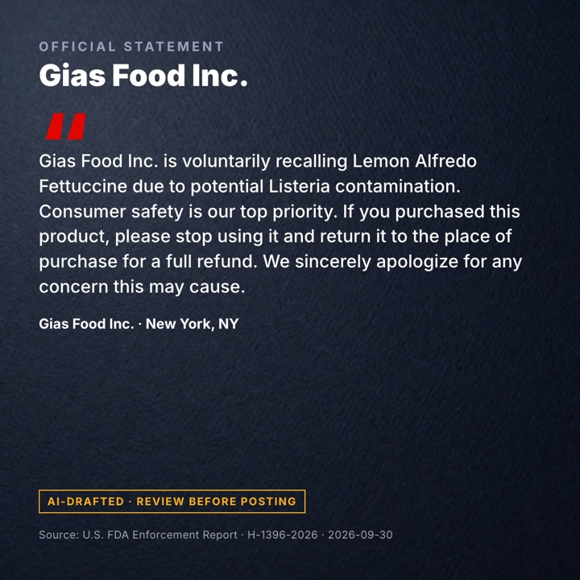
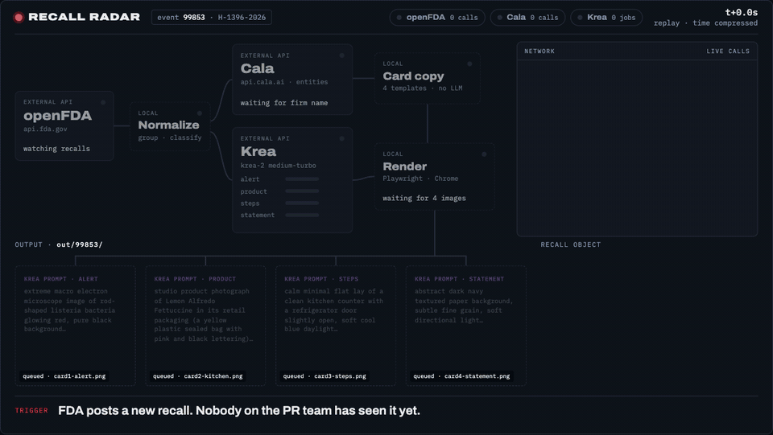
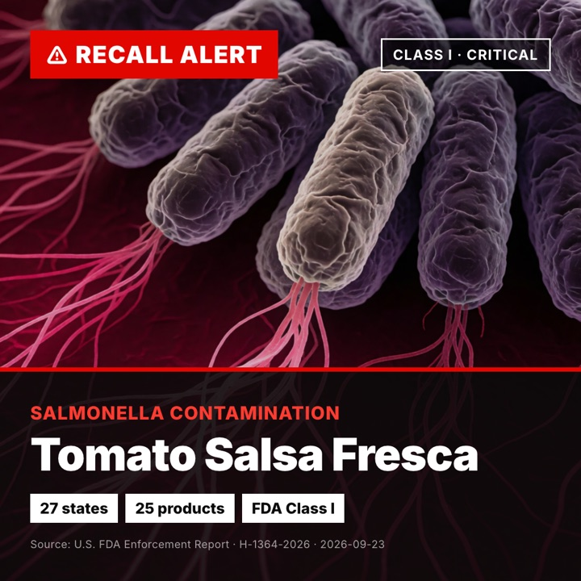
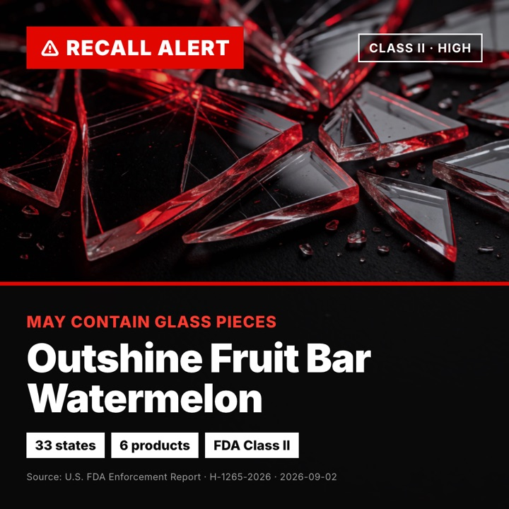
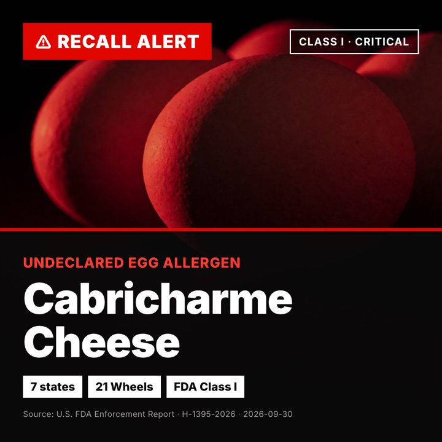

<div align="center">

# 🚨 Recall Radar

### The FDA posts a recall. Four ready-to-post social cards are done before the PR team opens the email.

**openFDA → Cala → Krea → 📱 4 cards. Zero clicks. Zero designers.**

<br/>


<sub>Built at the <b>Creative Data Hackathon</b> (Krea × Cala × Lovable) · SF Tech Week · October 10, 2026</sub>

</div>

---

## 🎯 Real recall, real output

FDA event `99853`: **Lemon Alfredo Fettuccine**, Class I, Listeria, nationwide.
Nobody picked this recall, wrote copy, or opened a design tool. The pipeline made all four cards from the FDA record:

<table>
  <tr>
    <td align="center"><br/><b>① Recall Alert</b><br/><sub>What, how bad, where</sub></td>
    <td align="center"><br/><b>② Check Your Kitchen</b><br/><sub>Brand, product, real lot codes</sub></td>
    <td align="center"><br/><b>③ What To Do</b><br/><sub>Four clear consumer steps</sub></td>
    <td align="center"><br/><b>④ Official Statement</b><br/><sub>AI-drafted, flagged for review</sub></td>
  </tr>
</table>

---

## 😰 The problem

When a food recall hits, the clock starts. Consumers need to know **right now** whether the thing in their fridge is dangerous. Brands usually need **hours to days** to respond:

> FDA posts the recall → someone on the PR team notices → legal weighs in → a designer is pulled in → copy goes back and forth → *finally* something gets posted.

Every hour of that silence costs two things:

- **Public safety.** People keep eating a Listeria-contaminated product because nobody told them in a format they actually see.
- **Brand trust.** The story gets told by news outlets and angry posts instead of the brand.

The data needed to respond is **already public** the moment the FDA posts. It's just stuck in a government JSON feed that nobody reads.

## 💡 Our answer

**Recall Radar turns that feed into a ready-to-post crisis response.** Automatically, as soon as the recall appears.

| | Before | With Recall Radar |
|---|---|---|
| ⏱️ Time to first post | hours to days | **minutes** |
| 🎨 Design work | designer + several rounds | **none** |
| 🔢 Lot codes & affected states | retyped by hand, easy to get wrong | **pulled straight from the FDA record** |
| 🗣️ Official statement | drafted from scratch under pressure | **drafted, labeled, ready to review** |

**Who uses it:** brand PR and comms teams.
**Who it's for:** the consumers scrolling past it, who find out in seconds whether to check their kitchen.

---

## ⚙️ How it works

### ▶ Watch one real run, start to finish

<p align="center">
  
</p>

<p align="center"><sub>
A replay of real <code>npm run generate</code> output for event 99853. Every openFDA, Cala and Krea call lights up as it happens, and the four cards fill in at the bottom. Krea wait time is compressed.<br/>
🕹️ <b><a href="docs/pipeline/index.html">Interactive version</a></b>: scrub the timeline, jump between chapters, or switch to a second recall (clone the repo and open it in a browser) · 🎬 <a href="docs/pipeline/pipeline.mp4">MP4</a>
</sub></p>

### Under the hood

```
   🏛️  openFDA Enforcement API          what was recalled, why, where, which lots
            │
            ▼
   🧩  Normalize + classify             merge per-state rows into one recall event,
            │                           tag the hazard (Listeria, Salmonella, glass, allergen…)
            ▼
   🏢  Cala                             who the company is: verified entity + recent news
            │
            ▼
   🎨  Krea                             hazard-specific warning art, AI product shot, textures
            │
            ▼
   🖼️  HTML templates → Playwright      exact, legible text over the visuals → 4 × 1080² PNG
            │
            ▼
   📱  Lovable app                      browse recalls, preview and share the cards
```

### How each sponsor fits in

**🏢 Cala: who is behind the recall.** FDA tells us *what* was recalled. Cala tells us *who* the company is and *what's going on around them*. We look up the recalling firm as a verified entity to ground the official statement, and optionally run a knowledge search for recent news and past recalls. We added strict name matching because fuzzy search will otherwise map "GIAS FOOD" to an unrelated company in Luxembourg, and a crisis statement can't name the wrong company.

**🎨 Krea: a different visual for every recall.** Each hazard gets its own art direction: rod-shaped bacteria for Listeria, flagellated cells for Salmonella, shattered glass for foreign material, a close-up of the allergen itself. The product shot is generated from the label text in the FDA record, so a recall with no product photo still gets a recognizable package.

**💜 Lovable: where it shows up.** The Lovable app gives the team a live view: a Walmart recall map that ties recent food recalls to stores, with Cala and Krea wired in.

### One pipeline, every hazard

Same code, different recalls. Each hazard gets its own visual language:

<table>
  <tr>
    <td align="center"><br/><sub>Salmonella · 27 states</sub></td>
    <td align="center"><br/><sub>Glass fragments · 33 states</sub></td>
    <td align="center"><br/><sub>Undeclared egg · 7 states</sub></td>
  </tr>
</table>

---

## 🛡️ Built for trust, not just speed

A recall card that's wrong is worse than no card. We studied an existing recall-card app and designed against every failure we found:

- **No text inside AI images.** Krea makes the visuals. Every word is rendered as HTML on top, so product names, numbers and codes are always exact and never garbled.
- **Real lot codes, never invented.** Card ② prints the actual `code_info` from the FDA record. No "check source" placeholders and no made-up example lots.
- **Correct hazard classification.** Ordered, explicit rules (a Listeria recall that also mentions allergens is still a Listeria recall), and the specific allergen is named: *egg* gets an egg, not a peanut.
- **Full product names.** We extract a short consumer-facing name from the raw label text instead of truncating mid-word.
- **AI is labeled as AI.** The product shot is tagged `AI ILLUSTRATION`. The statement is stamped `AI-DRAFTED · REVIEW BEFORE POSTING`. A human approves before anything goes public.
- **Every card cites its source.** FDA recall number and report date on every card.

### Taming messy FDA data

openFDA isn't built for this. A single recall is split across many rows (one per product or state), quantities come in a dozen formats, and `product_description` is the full label pasted as-is. We group rows by `event_id`, merge quantities and distribution states, and pull out a clean product name, so one recall becomes one set of cards.

---

## 🚀 Run it

```bash
git clone https://github.com/martinmnstr/kreahackathon.git
cd kreahackathon
npm install
cp .env.example .env       # set KREA_API_KEY and CALA_API_KEY
```

```bash
npm run list                              # recent recall events from openFDA
npm run generate                          # cards for the newest recall
npm run generate -- --event 99853         # cards for a specific recall
```

Cards land in `out/<event_id>/` (`card1-alert.png` … `card4-statement.png`, plus `recall.json` with all the data, prompts and copy).

<details>
<summary><b>Options</b></summary>

| Flag | What it does |
|---|---|
| `--event <id>` | Generate for a specific FDA event |
| `--name "Short Name"` | Override the extracted product name |
| `--news` | Add a Cala knowledge search for company news (~60–90s, cached in `out/.cache/cala`) |
| `--no-images` | Skip Krea and render on plain backgrounds |
| `--no-cala` | Skip company lookup |

Requirements: Node 22+ and Google Chrome (Playwright renders with the installed Chrome). openFDA needs no key.

</details>

<details>
<summary><b>Repo layout</b></summary>

```
generate.js        entry point: FDA → Cala → Krea → PNG cards
lib/fda.js         openFDA fetch, event grouping, hazard classification
lib/cala.js        company entity lookup + cached news search
lib/krea.js        image generation, polling, download
lib/prompts.js     hazard-specific Krea prompts
lib/cards.js       card copy + 1080×1080 HTML templates
app/               Lovable web app (Walmart recall map)
docs/cards/        sample output shown in this README
docs/pipeline/     pipeline motion graphic (interactive HTML + GIF/MP4)
```

</details>

---

## 🔭 What's next

- **Always-on watcher.** Poll openFDA on a schedule and push new card sets to the comms team (Slack/email) the moment a recall drops.
- **Reels.** Stitch the four cards into a short vertical video.
- **Brand kits.** The company's own colors, logo and voice, so the cards look like the company made them.
- **Beyond food.** openFDA also publishes drug and device recalls, and the same pipeline applies.

---

<div align="center">

**Every hour without a response erodes trust. Recall Radar gets that hour back.**

<sub>Recall data: U.S. FDA Enforcement Reports via <a href="https://open.fda.gov">openFDA</a>. Product images are AI illustrations, not photos of actual products. Statements are AI drafts and must be reviewed before publishing.</sub>

</div>
